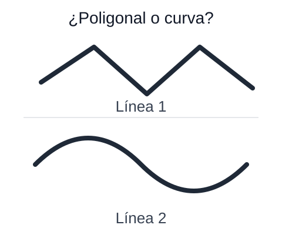
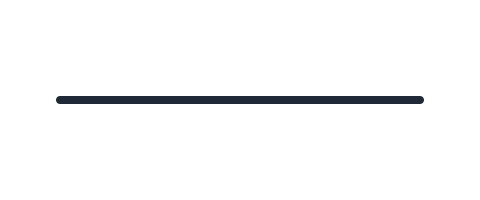
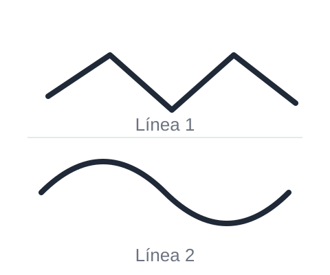

# Líneas poligonales y curvas

Identificar y diferenciar tipos de líneas.

## Resumen

Identificar y diferenciar tipos de líneas.
- **Líneas curvas:** tienen curvatura.
- **Líneas poligonales (rectas):** formadas por segmentos rectos.

**Punto clave:** reconocerlas y diferenciarlas en distintos dibujos y situaciones.

### Imágenes de apoyo

Una **línea recta** no tiene curvas ni esquinas:

Una **línea poligonal** está formada por varios segmentos rectos unidos:

Una **línea curva** tiene curvatura, no tiene tramos rectos:

Comparación de las dos últimas:

## Flashcards

| Frente | Reverso |
| --- | --- |
| ¿Qué es una línea curva? | Una línea que tiene curvatura |
| ¿Qué es una línea poligonal? | Una línea formada por varios segmentos rectos |

## Quiz A: Identificar líneas

Descripción: Reconoce las líneas poligonales y curvas.

**1. ¿Cómo es una línea poligonal?**
- Está formada por segmentos rectos — ¡Sí! Son tramos rectos unidos. ✔
- Tiene muchas curvas — Eso describe una línea curva, no una poligonal.
- Es siempre un círculo — El círculo es una figura, no una línea poligonal.

**2. Verdadero o falso: Las líneas curvas tienen curvatura.**
- Verdadero ✔ — Las líneas curvas no son rectas: se doblan o tienen curvatura.
- Falso — Las líneas curvas se doblan, por eso sí tienen curvatura.

**3. Observa la figura. ¿Es una línea poligonal o una línea curva?**

- Una línea poligonal — ¡Sí! Está formada por segmentos rectos unidos. ✔
- Una línea curva — La figura tiene tramos rectos; no se dobla.

**4. Observa la figura. ¿Es una línea poligonal o una línea curva?**

- Una línea curva — ¡Sí! La figura se dobla, no tiene tramos rectos. ✔
- Una línea poligonal — La figura no está formada por segmentos rectos, sino que tiene curvatura.

**5. Observa la figura. La línea tiene \_\_\_ segmentos rectos.**

- Respuesta: 4 (teclado numérico, sin fichas)
- Pista si se equivoca: Cuenta los tramos rectos que van de un vértice al siguiente.
- Explicación: La línea tiene 4 tramos rectos unidos.

**6. Observa la figura. ¿Es una línea recta?**

- Sí — ¡Sí! Es un solo tramo recto, sin curvas ni esquinas. ✔
- No — La figura no se dobla ni tiene esquinas, así que sí es una línea recta.

**7. Verdadero o falso: Una línea recta tiene curvatura.**
- Verdadero — Una línea recta no se dobla, así que no tiene curvatura.
- Falso ✔ — Una línea recta no tiene curvatura: es un solo tramo recto.

**8. Observa las dos figuras. ¿Cuál es la línea curva?**

- La línea 2 — ¡Sí! La línea 2 se dobla y no tiene tramos rectos. ✔
- La línea 1 — La línea 1 está formada por segmentos rectos, así que es poligonal.
